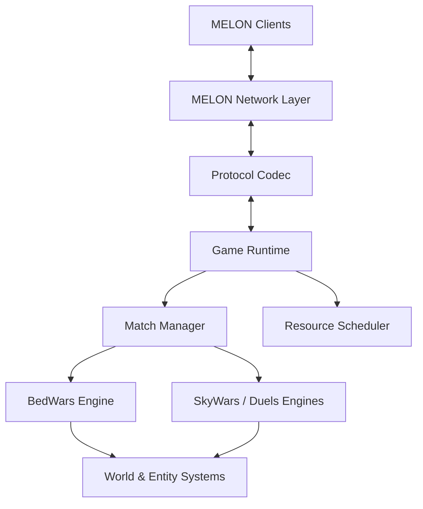
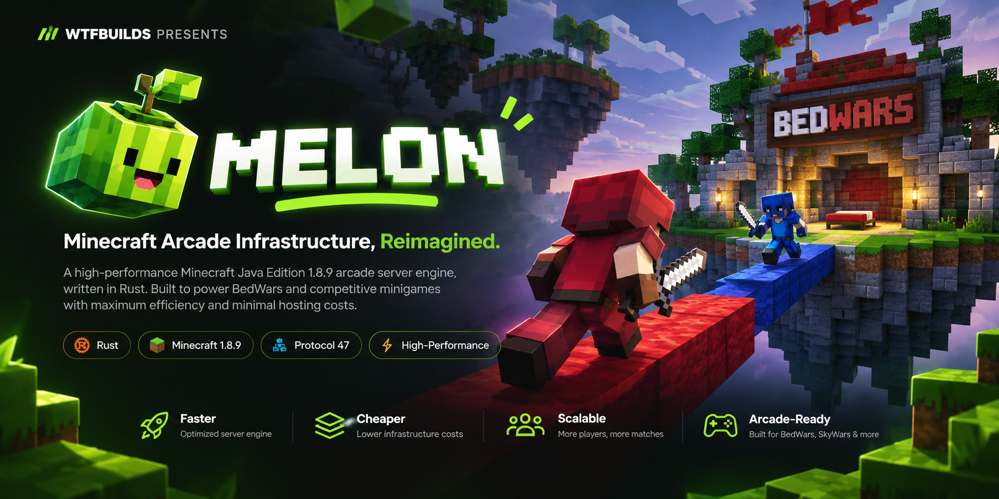

<div align="center">


# MELON

### Minecraft Arcade Infrastructure, Reimagined.

**A lightweight Minecraft-style arcade platform — playable client and game server, written in Rust.**


*More players. More matches. Less infrastructure.*

</div>

---

## Overview

Running a competitive Minecraft arcade network shouldn't require enormous infrastructure budgets — yet that is exactly what traditional server architectures demand.

**MELON** is being built as a purpose-built arcade platform rather than another general-purpose Minecraft server implementation. Its own lightweight client and server speak a clean, versioned binary protocol — no legacy baggage — and the runtime is designed from the ground up to host large numbers of isolated, concurrent minigame matches on minimal hardware, starting with BedWars.

> ### 🎯 Mission
> **More players. More matches. Less infrastructure.**
> Maximize player density per machine. Minimize CPU, memory, and operating cost per match.

## Why MELON?

| Traditional Java Servers | The MELON Approach |
| :--- | :--- |
| General-purpose platform carrying decades of compatibility surface | Purpose-built arcade engine with a narrow, focused protocol target |
| Heavy per-instance memory footprint | Minimal per-match overhead, designed for density |
| One JVM process per instance, or shared worlds with compromises | Isolated matches running efficiently within a single native runtime |
| Optimized by convention, not by measurement | Driven by a public benchmarking methodology from day one |

### Design Principles

- ⚡ **Performance** — Efficient game simulation and packet processing on the hot path.
- 🧠 **Resource efficiency** — Minimize CPU and memory overhead per player and per match.
- 🔀 **Concurrency** — Run many isolated matches in parallel without interference.
- 📉 **Low latency** — Sub-tick responsiveness for movement, combat, and knockback.
- 📈 **Scalability** — Maximum concurrent players and matches per machine.
- 💰 **Affordability** — Lower the infrastructure cost of operating an arcade network.

## Architecture



## Core Components

| Component | Responsibility |
| :--- | :--- |
| **Protocol** | MELON wire protocol — versioned handshake, framed messages |
| **Networking** | TLS-capable TCP transport and codec pipeline |
| **Runtime** | Deterministic game loops and tick scheduling |
| **World** | Blocks, chunks, and world state management |
| **Entities** | Player and entity simulation |
| **Combat** | PvP, hit detection, and knockback tuning |
| **Matchmaking** | Match allocation, queueing, and lifecycle |
| **Game Modes** | BedWars, SkyWars, and Duels engines |

## Game Modes

<div align="center">
  
</div>

### BedWars First. Arcade Infrastructure Next.

BedWars is the first and primary optimization target. It stresses every part of the engine — block manipulation, entity physics, projectile handling, and combat — making it the perfect proving ground for the runtime. SkyWars and Duels will follow on the same shared foundation.

## Technology Stack

| Layer | Technology |
| :--- | :--- |
| Core language | Rust |
| Wire protocol | MELON protocol v1 — compact binary, versioned |
| Transport | TLS-capable TCP |
| Client renderer | wgpu |
| Architecture | Shared workspace: `melon-proto` + `melon-world` power both sides |
| Concurrency | Async I/O with dedicated tick schedulers |

## Performance Engineering

We don't optimize based on assumptions — we optimize based on measurement. MELON's benchmarking methodology will track:

- Concurrent players per CPU core
- Memory consumption per active player
- Concurrent matches per machine
- P95 / P99 tick processing latency
- Network bandwidth per player
- Infrastructure cost per 1,000 player-hours

<details>
<summary><strong>Benchmarking methodology</strong></summary>

<br />

- Performance comparisons will use **equivalent workloads** against established Java server implementations.
- Scenarios will simulate real arcade traffic patterns: lobby flow, match starts, team fights, block updates, and end-of-match resets.
- Results, harnesses, and raw data will be published in the `benchmarks/` directory so every number is reproducible.

</details>

## Roadmap

**Phase 1 — Foundation** · *✅ complete*
- [x] Cargo workspace: 5 crates, CI, quality gates
- [x] MELON wire protocol v1 (handshake, auth, framing)
- [x] Client/server session spine with live ping/pong

**Phase 2 — Client Core** · *🚧 in progress*
- [ ] wgpu renderer: chunk meshing, texture atlas
- [ ] Fly camera and movement
- [ ] Render-benchmark gate

**Phase 3 — Connected World**
- [ ] Server-hosted worlds with chunk streaming
- [ ] Block place/break sync
- [ ] Presence and chat

**Phase 4 — Game Layer**
- [ ] Combat and 1.8-style knockback
- [ ] Arena format and vanilla map import
- [ ] BedWars vertical slice

**Phase 5 — Scale & Launch**
- [ ] Vanilla 1.8.9 bridge gateway
- [ ] Performance benchmarking suite
- [ ] SkyWars and Duels support
- [ ] Arcade orchestration infrastructure

*Progress is tracked checkbox-by-checkbox in [plan.md](plan.md).*

## Project Structure

```text
melon/
├── crates/
│   ├── melon-proto/    # Wire protocol: framing, codec, message types
│   ├── melon-world/    # Shared world model: blocks, chunks, arenas
│   ├── melon-server/   # Lightweight game server (match actors, 20 TPS)
│   ├── melon-client/   # Playable client (wgpu) + headless bot mode
│   └── melon-tools/    # Arena converter, benchmark bots, admin CLI
├── docs/               # Engine plan & reference analyses
├── website/            # Landing site (Next.js)
├── assets/             # Project branding & artwork
├── reference/          # Reference artifacts (see docs for policy)
├── plan.md             # Execution tracker
└── Cargo.toml          # Rust workspace
```

## Documentation

- [Engine Plan — Rebuilding Minecraft 1.8.9 in Rust](docs/engine-plan.md) — strategy, architecture, and the milestone ladder
- [Reference Analysis — Vanilla 1.8.9 Server Jar](docs/reference/minecraft-server-1.8.9.md) — static analysis of `server.jar` and our clean-room policy

## Getting Started

One command does everything — including installing Rust if it's missing:

```bash
git clone https://github.com/WTFBuilds/Minecraft-Rust-Cracked.git
cd Minecraft-Rust-Cracked
./setup.sh              # build + demo: server starts, a headless client pings it
./setup.sh client       # open the game window (Phase 2 world)
./setup.sh play         # server in background + game window together
./setup.sh test         # fmt + clippy + all tests
```

All launcher commands: `./setup.sh -h` (env overrides: `MELON_PORT`, `MELON_PLAYER`, …).

The platform is in active development — Phase 2 (client renders a world) just shipped; see [plan.md](plan.md) for what's next. Contributors need a stable [Rust](https://rustup.rs) toolchain (the setup script installs it) and Git.

## Contributing

We're building MELON for developers who enjoy systems programming, networking, game engines, and performance engineering. If you're interested in pushing multiplayer infrastructure beyond conventional boundaries, we'd love to have you involved.

1. Fork the repository and create your branch from `main`
2. Open an issue to discuss significant changes before implementing
3. Keep pull requests focused — one feature or fix per PR

## License

This project is licensed under the [MIT License](LICENSE).

## About WTFBUILDS

MELON is an independent engineering project under **WTFBUILDS** — *Witness The Future Builds*. We build software, platforms, infrastructure, robotics, and technology that pushes beyond conventional boundaries.

<div align="center">
  
</div>

🔗 **Website:** [melon.wtfbuilds.com](https://melon.wtfbuilds.com) · **Organization:** [wtfbuilds.com](https://wtfbuilds.com)

---

<div align="center">

<strong>Built with Rust. Designed for scale. Made for the game.</strong>

<sub>A WTFBUILDS project · 2026</sub>

🍈

</div>
