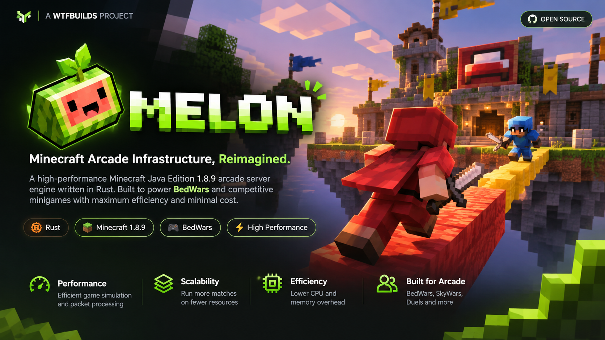
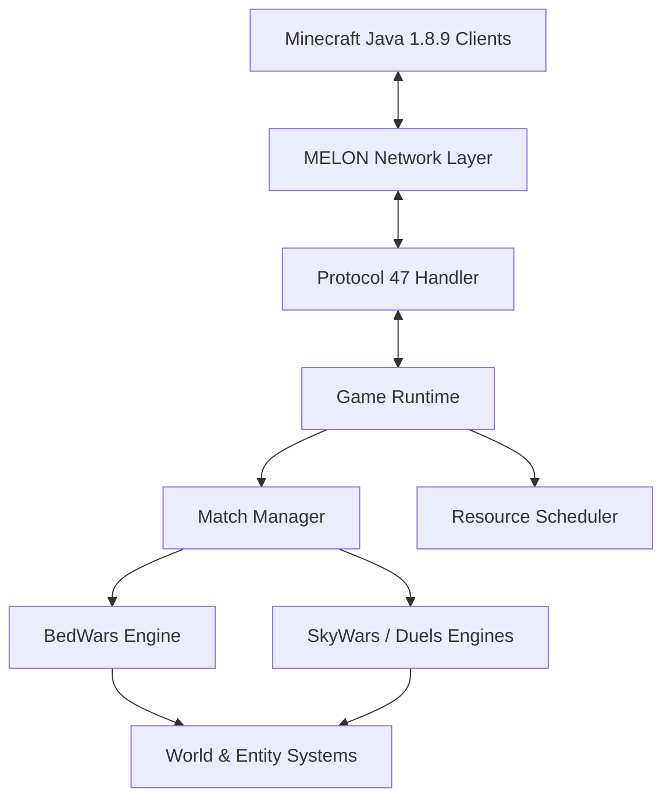
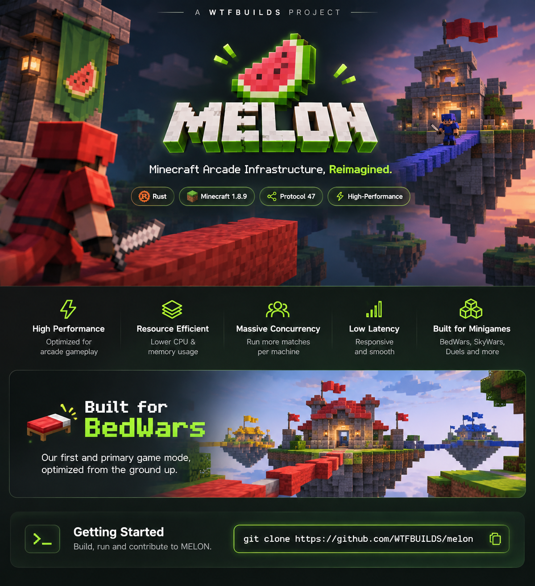

<div align="center">



# MELON

### Minecraft Arcade Infrastructure, Reimagined.

**A high-performance Minecraft Java Edition 1.8.9 arcade server engine, written in Rust.**


*More players. More matches. Less infrastructure.*

</div>

---

## Overview

Running a competitive Minecraft arcade network shouldn't require enormous infrastructure budgets — yet that is exactly what traditional server architectures demand.

**MELON** is being built as a purpose-built arcade engine rather than another general-purpose Minecraft server implementation. It is designed from the ground up to run large numbers of isolated, concurrent minigame matches on minimal hardware — starting with 1.8.9 BedWars, the most latency-sensitive and infrastructure-hungry mode in competitive Minecraft.

> ### 🎯 Mission
> **More players. More matches. Less infrastructure.**
> Maximize player density per machine. Minimize CPU, memory, and operating cost per match.

## Why MELON?

| Traditional Java Servers | The MELON Approach |
| :--- | :--- |
| General-purpose platform carrying decades of compatibility surface | Purpose-built arcade engine with a narrow, focused protocol target |
| Heavy per-instance memory footprint | Minimal per-match overhead, designed for density |
| One JVM process per instance, or shared worlds with compromises | Isolated matches running efficiently within a single native runtime |
| Optimized by convention, not by measurement | Driven by a public benchmarking methodology from day one |

### Design Principles

- ⚡ **Performance** — Efficient game simulation and packet processing on the hot path.
- 🧠 **Resource efficiency** — Minimize CPU and memory overhead per player and per match.
- 🔀 **Concurrency** — Run many isolated matches in parallel without interference.
- 📉 **Low latency** — Sub-tick responsiveness for movement, combat, and knockback.
- 📈 **Scalability** — Maximum concurrent players and matches per machine.
- 💰 **Affordability** — Lower the infrastructure cost of operating an arcade network.

## Architecture



## Core Components

| Component | Responsibility |
| :--- | :--- |
| **Protocol** | Minecraft 1.8.9 (Protocol 47) compatibility layer |
| **Networking** | TCP connection handling and packet codec pipeline |
| **Runtime** | Deterministic game loops and tick scheduling |
| **World** | Blocks, chunks, and world state management |
| **Entities** | Player and entity simulation |
| **Combat** | PvP, hit detection, and knockback tuning |
| **Matchmaking** | Match allocation, queueing, and lifecycle |
| **Game Modes** | BedWars, SkyWars, and Duels engines |

## Game Modes

<div align="center">
  
</div>

### BedWars First. Arcade Infrastructure Next.

BedWars is the first and primary optimization target. It stresses every part of the engine — block manipulation, entity physics, projectile handling, and combat — making it the perfect proving ground for the runtime. SkyWars and Duels will follow on the same shared foundation.

## Technology Stack

| Layer | Technology |
| :--- | :--- |
| Core language | Rust |
| Protocol target | Minecraft Protocol 47 (Java Edition 1.8.9) |
| Transport | TCP |
| Architecture | Modular, multi-crate engine |
| Concurrency | Async I/O with dedicated tick schedulers |

## Performance Engineering

We don't optimize based on assumptions — we optimize based on measurement. MELON's benchmarking methodology will track:

- Concurrent players per CPU core
- Memory consumption per active player
- Concurrent matches per machine
- P95 / P99 tick processing latency
- Network bandwidth per player
- Infrastructure cost per 1,000 player-hours

<details>
<summary><strong>Benchmarking methodology</strong></summary>

<br />

- Performance comparisons will use **equivalent workloads** against established Java server implementations.
- Scenarios will simulate real arcade traffic patterns: lobby flow, match starts, team fights, block updates, and end-of-match resets.
- Results, harnesses, and raw data will be published in the `benchmarks/` directory so every number is reproducible.

</details>

## Roadmap

**Phase 1 — Foundation**
- [ ] Project foundation and core architecture
- [ ] Minecraft 1.8.9 protocol implementation
- [ ] Client handshake and login

**Phase 2 — Engine Core**
- [ ] Player movement and synchronization
- [ ] World and chunk management
- [ ] Multi-match runtime

**Phase 3 — Game Layer**
- [ ] BedWars engine
- [ ] Combat, inventory, and item systems
- [ ] Matchmaking and lobby flow

**Phase 4 — Scale & Launch**
- [ ] Performance benchmarking suite
- [ ] Production deployment
- [ ] SkyWars and Duels support
- [ ] Arcade orchestration infrastructure

## Project Structure

```text
melon/
├── crates/
│   ├── protocol/      # Minecraft protocol 47 codec
│   ├── networking/    # TCP transport & packet pipeline
│   ├── runtime/       # Game loops & tick scheduling
│   ├── world/         # Blocks, chunks & world state
│   ├── entities/      # Player & entity simulation
│   ├── combat/        # PvP, hit detection & knockback
│   ├── matchmaking/   # Match allocation & lifecycle
│   └── game-modes/    # BedWars, SkyWars, Duels
├── assets/            # Project branding & artwork
├── benchmarks/        # Reproducible performance harnesses
├── docs/              # Design documents & specifications
├── tests/             # Integration & protocol tests
├── Cargo.toml
└── README.md
```

*Planned structure — subject to change during development.*

## Getting Started

The engine is in active development — the first public build will ship alongside the initial protocol implementation.

```bash
git clone https://github.com/WTFBuilds/Minecraft-Rust-Cracked.git
cd Minecraft-Rust-Cracked
```

**Prerequisites (for contributors):** a stable [Rust](https://rustup.rs) toolchain and Git. Build and run instructions will be documented here as crates land.

## Contributing

We're building MELON for developers who enjoy systems programming, networking, game engines, and performance engineering. If you're interested in pushing multiplayer infrastructure beyond conventional boundaries, we'd love to have you involved.

1. Fork the repository and create your branch from `main`
2. Open an issue to discuss significant changes before implementing
3. Keep pull requests focused — one feature or fix per PR

## License

This project is licensed under the [MIT License](LICENSE).

## About WTFBUILDS

MELON is an independent engineering project under **WTFBUILDS** — *Witness The Future Builds*. We build software, platforms, infrastructure, robotics, and technology that pushes beyond conventional boundaries.

<div align="center">
  
</div>

🔗 **Website:** [melon.wtfbuilds.com](https://melon.wtfbuilds.com) · **Organization:** [wtfbuilds.com](https://wtfbuilds.com)

---

<div align="center">

<strong>Built with Rust. Designed for scale. Made for the game.</strong>

<sub>A WTFBUILDS project · 2026</sub>

🍈

</div>
