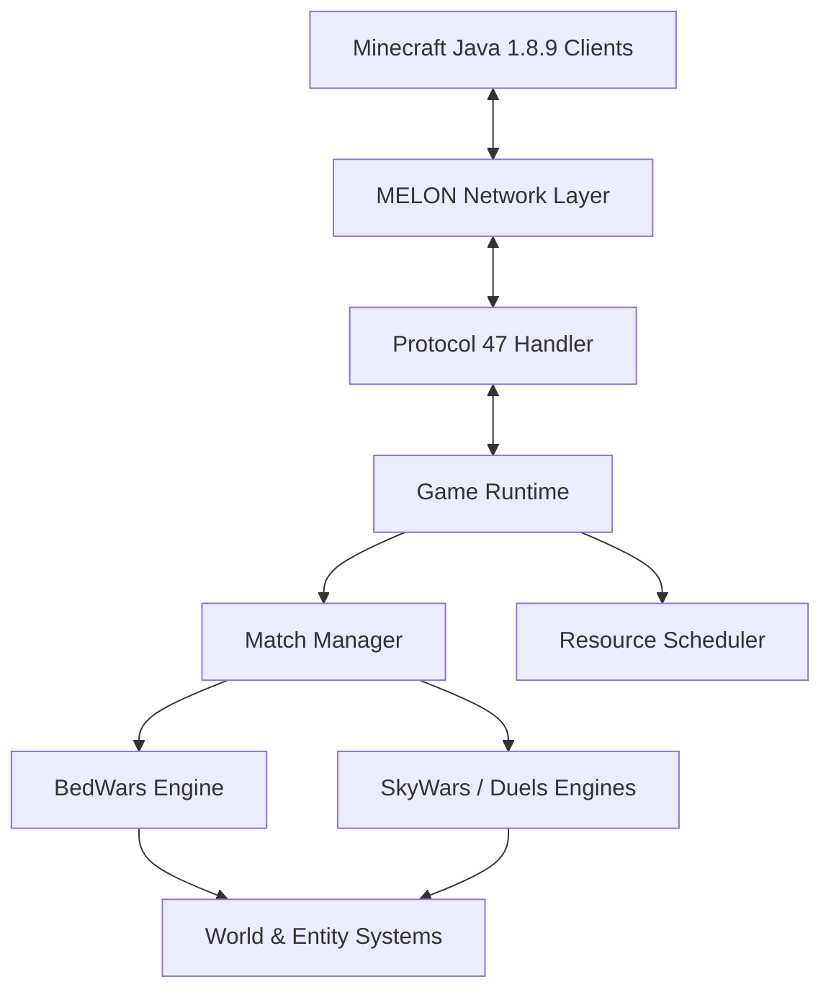

# 🍈 MELON

### Minecraft Arcade Infrastructure, Reimagined.

**MELON** is a high-performance Minecraft Java Edition 1.8.9 arcade server engine, written in Rust.

We're rethinking Minecraft arcade infrastructure from the ground up — building a specialized, resource-efficient engine designed to power competitive minigames like BedWars, SkyWars and Duels.

Our mission is simple: **More players. More matches. Less infrastructure.**

<p align="center">
  
</p>

<p align="center">
  
  
  
  
</p>

---

## The Problem

Running a competitive Minecraft arcade network shouldn't require enormous infrastructure budgets.

Traditional server architectures can introduce unnecessary resource overhead when hosting large numbers of independent game instances.

For networks running hundreds of simultaneous matches, every CPU cycle and megabyte of memory matters.

## Our Approach

MELON is being designed as a purpose-built Minecraft arcade engine rather than another general-purpose Minecraft server implementation.

Written in Rust, the project focuses on:

- **Performance** — Efficient game simulation and packet processing.
- **Resource efficiency** — Minimize CPU and memory overhead.
- **Concurrency** — Handle multiple isolated matches efficiently.
- **Low latency** — Optimize networking and game-loop execution.
- **Scalability** — Maximize player density per machine.
- **Affordability** — Reduce the cost of operating arcade infrastructure.

## Architecture



## Core Components

| Component | Responsibility |
|---|---|
| Protocol | Minecraft 1.8.9 compatibility |
| Networking | TCP connections and packet processing |
| Runtime | Game loops and scheduling |
| World | Blocks, chunks and world state |
| Entities | Players and entity simulation |
| Combat | PvP, hit detection and knockback |
| Matchmaking | Match allocation and lifecycle |
| Game Modes | BedWars, SkyWars and Duels |

## Built For

<p align="center">
  
  
</p>

**BedWars First. Arcade Infrastructure Next.**

Our first optimization target is Minecraft 1.8.9 BedWars, with a long-term vision of supporting multiple competitive minigames through a shared runtime.

### Technology Stack

| Layer | Technology |
|---|---|
| Core | Rust |
| Protocol | Minecraft Protocol 47 |
| Transport | TCP |
| Architecture | Modular engine |
| Target | Minecraft Java Edition 1.8.9 |

## Performance Engineering

We don't want to optimize based on assumptions. We want measurable improvements.

Our benchmarking methodology will focus on:

- Concurrent players per CPU core
- Memory consumption per active player
- Concurrent matches per machine
- P95 / P99 tick processing latency
- Network bandwidth per player
- Infrastructure cost per 1,000 player-hours

Performance comparisons will use equivalent workloads against established Java server implementations.

## Roadmap

- [ ] Project foundation and core architecture
- [ ] Minecraft 1.8.9 protocol implementation
- [ ] Client handshake and login
- [ ] Player movement and synchronization
- [ ] World and chunk management
- [ ] Multi-match runtime
- [ ] BedWars engine
- [ ] Combat and inventory systems
- [ ] Performance benchmarking
- [ ] Production deployment
- [ ] SkyWars and Duels support
- [ ] Arcade orchestration infrastructure

## Project Structure

```text
melon/
├── crates/
│   ├── protocol/
│   ├── networking/
│   ├── runtime/
│   ├── world/
│   ├── entities/
│   ├── combat/
│   ├── matchmaking/
│   └── game-modes/
├── assets/
├── benchmarks/
├── docs/
├── tests/
├── Cargo.toml
└── README.md
```

*Planned structure — subject to change during development.*

## Contributing

We're building MELON for developers who enjoy systems programming, networking, game engines, and performance engineering.

If you're interested in building better multiplayer infrastructure, we'd love to have you involved.

## Part of WTFBUILDS

MELON is an independent engineering project under **WTFBUILDS** — Witness The Future Builds.

We're building software, platforms, infrastructure, robotics, and technology that pushes beyond conventional boundaries.

**Website:** https://melon.wtfbuilds.com  
**Organization:** https://wtfbuilds.com

---

<p align="center">
  <strong>Built with Rust. Designed for scale. Made for the game.</strong>
  <br />
  <sub>A WTFBUILDS project · 2026</sub>
</p>
